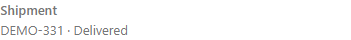

# Shipment Tracking Bridge for WooCommerce

An original CodexaWP portfolio demo for receiving carrier updates. A signed REST request attaches one sample shipment to a WooCommerce order. The tracking number and latest status appear for staff and on the order details page.

## Try it

Set `CODEXAWP_CARRIER_SECRET` in the test site's configuration. Send `POST /wp-json/codexawp-carrier/v1/events` with JSON containing `orderId`, `tracking`, `eventId`, `sequence` and `stage`. The accepted stages are `dispatched`, `in_transit` and `delivered`. The test fixture shows how a carrier signs the timestamp and exact request body and exercises this route without a live carrier.

## Verification

Activate this plugin on a disposable WordPress site with WooCommerce active and `WP_ENVIRONMENT_TYPE` set to `local`. Set `CODEXAWP_TEST_WP_LOAD` to the absolute path to that site's `wp-load.php`, then run `php tests/check.php` from this repository.

Checks assert signature rejection, replay handling, monotonic shipment status and saved WooCommerce order metadata.

## License

GPL-2.0-or-later. See [LICENSE](LICENSE).
